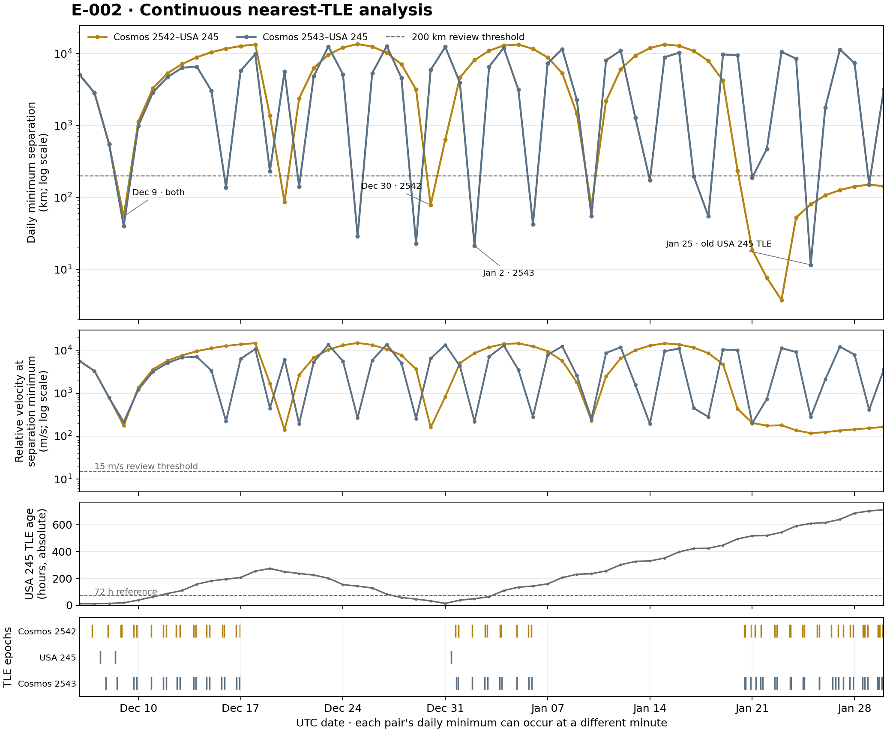

# E-002 candidate chapter analysis · November 15, 2026

This is an **experimental SGP4 reconstruction**, not a measured close-approach catalog. The published E-002 chapters remain December 7, 8, and 31, 2019. No chapter dates, sheet fields, or public TLE-age gates changed in this pass.

## Method

I reproduced the seven candidate anchors with [`analyze_chapters.py`](analyze_chapters.py). The script verifies SHA-256 hashes in the [source manifest](data/provenance.json), selects the nearest Kosmos 2542 (A, 44797) element, and selects the USA 245 (B, 39232) element used in [Willa Madsen's original storyline](https://github.com/willamadsen/How-Close-Is-Too-Close/blob/compare-wip/Viz/data/eci_storyline.json) for her four anchors. For the three current anchors, it selects the nearest B element. It propagates both with SGP4 at the anchor and at one-minute intervals over a **six-hour search window centered on the anchor**. The table reports the lowest sampled separation and the relative speed at that sampled instant. Some six-hour minima lie outside today's shorter public chapter windows, so these figures are for comparison, not the values displayed in the current interface.

Element ages below are **signed hours at the anchor**: positive means propagation forward from an epoch, negative backward. An epoch is the element-fit time, not a spacecraft observation at the anchor. The alternatives column gives the range of minima from two nearest A choices crossed with the selected B and a nearby B alternative. It is a sensitivity check, **not a confidence interval**. The switch column gives the A/B position change at the anchor when swapping each element individually; a large switch warns that the reconstructed track can jump.

| Candidate anchor (UTC) | Selected A / B TLE epochs (UTC) | A / B ages at anchor | Six-hour modeled minimum, UTC | Relative speed at minimum | Alternatives; A / B switch | Data-quality concern | Recommendation |
| --- | --- | --- | --- | --- | --- | --- | --- |
| Dec. 7, 2019, 10:30 | Dec. 7 22:09 / Dec. 7 09:43 | −11.7 / +0.8 h | 3,727 km, Dec. 7 13:26 | 4,226 m/s | 3,727–3,750 km; 5 / 62 km | Closest sample lies beyond the current 09:45–11:15 window; no close A/B encounter. | Keep only as a dated-element context view. |
| Dec. 8, 2019, 10:50 | Dec. 8 19:10 / Dec. 8 10:03 | −8.3 / +0.8 h | 1,479 km, Dec. 8 13:47 | 1,806 m/s | 1,437–1,479 km; 0 / 82 km | Both elements are relatively near their epochs, but the minimum is beyond the current 10:05–11:35 window. | Keep as the best current data-backed A/B context view, not a close-pass claim. |
| Dec. 31, 2019, 18:45 | Dec. 31 16:54 / Dec. 31 09:35 | +1.8 / +9.2 h | 3,344 km, Dec. 31 16:58 | 3,667 m/s | 3,344–3,910 km; 0 / 469 km | Nearby element choices disagree notably for B; minimum precedes the current 18:00 start. | Retain as a separate dated context view, with no minimum claim. |
| Dec. 9, 2019, 11:40 | Dec. 9 16:11 / Dec. 8 10:03 | −4.5 / +25.6 h | 54.5 km, Dec. 9 11:40 | 175 m/s | 54.5–70.8 km; 0 / 116 km | First informative modeled A/B convergence, but B is over a day old and its alternate changes position by more than the nominal separation. | **Best experimental close-pass candidate.** Label as illustrative until a nearer B set or independent reconstruction validates it. |
| Dec. 16, 2019, 17:02 | Dec. 16 16:21 / Dec. 31 09:35 | +0.7 / −352.5 h | 12,052 km, Dec. 16 19:57 | 12,888 m/s | 12,052–12,398 km; 0 / 11,009 km | Willa's selected B element is back-propagated ~15 days. Swapping B causes an enormous position jump; A/B is widely separated. | Do not use for quantitative proximity or an A/B close-pass chapter. |
| Jan. 2, 2020, 10:16 | Jan. 2 17:25 / Dec. 31 09:35 | −7.2 / +48.7 h | 9,114 km, Jan. 2 07:56 | 9,768 m/s | 6,912–9,114 km; 0 / 2,953 km | B is two days old; A/B remains thousands of kilometers apart. Willa's nearby C/B geometry concerns Kosmos 2543, which is not currently selected as A. | Do not add as a Kosmos 2542/USA 245 close-pass chapter. Reevaluate for a future C/B comparison. |
| Jan. 25, 2020, 18:35 | Jan. 25 14:10 / Dec. 31 09:35 | +4.4 / +609.0 h | 99.2 km, Jan. 25 17:09 | 118 m/s | 99–7,179 km; 0 / 7,428 km | Apparent proximity depends on a **25-day-old B element**. Switching B changes its propagated position by thousands of kilometers. | Historically important but unsuitable for a numeric chapter with this B library. |

Figures are rounded for this report only; the script retains full propagation precision. Its six-hour search is intentionally uniform across candidates. A wider search, a different pair, or a maneuver-aware model may find different minima. The separation range across alternate TLEs does not quantify physical accuracy because the public reconstructions lack covariance and may miss maneuvers.

## Historical interpretation and chapter recommendation

[Willa's original implementation](https://github.com/willamadsen/How-Close-Is-Too-Close/blob/compare-wip/Viz/case-study.js) organizes December 9 and 16, January 2, and January 25 into a useful visual story. Her saved [storyline data](https://github.com/willamadsen/How-Close-Is-Too-Close/blob/compare-wip/Viz/data/eci_storyline.json) yield modeled A/B distances of roughly 56 km, 12,193 km, 9,319 km, and 99 km at those anchors, respectively. The independent local calculations above reproduce their *order of magnitude* but reveal why a plotted value is not necessarily a defensible historical separation. In particular, December 16 uses a future B fit and January 25 extends the last 2019 B fit 25 days into 2020.

The [2024 GMV analysis](https://amostech.com/TechnicalPapers/2024/Poster/Serrano.pdf) reports close approaches and a January phase for Kosmos 2542 and USA 245, but it does not publish the exact B elements needed to reproduce those claims locally. Its reported minima are source-attributed findings, not replacements for missing B trajectories in this project.

For the next **experimental** sequence, I recommend **December 8 as a well-dated baseline, December 9 as the explicitly uncertain close-pass illustration, and December 31 as a later well-dated baseline**. The dates illustrate both a candidate convergence and how much source coverage matters. I would drop December 7 from the lead position because its A/B geometry adds little to this story, and would not make December 16 or January 2 quantitative A/B chapters. **January 25 merits a future chapter only after a dated January USA 245 element or another reproducible, independently assessed trajectory becomes available.** If the editorial aim is the entire Russian pair rather than only Kosmos 2542, January 2 should be reassessed separately for Kosmos 2543/USA 245 with explicit pair labeling.

An experimental view of December 9 could show the old B element with its signed age and a visible warning, while withholding an unqualified large numeric minimum and threshold dwell time. The interface must distinguish “SGP4 computed a trajectory” from “the trajectory supports a proximity claim.” The 12-hour statistics and 36-hour display gates remain appropriate defaults for the published view; a separately labeled experimental mode could relax them for illustration without treating their replacement as an uncertainty estimate.

To move January 25 or the reported January/February approaches into quantitative playback, obtain dated USA 245 elements from that interval, their provenance and redistribution status, and ideally independent fit or covariance information. A closer element alone would improve temporal coverage but would still not establish measured spacecraft separation.

## Continuous three-object supplement · November 16, 2026

This section extends the seven-anchor analysis above. It **supersedes the earlier advice against showing a Cosmos 2543 chapter**: the selector now keeps both Cosmos objects visible, and a separate C/B chapter would make its purpose clear. The earlier anchor table used one fixed TLE pair per six-hour window, with Willa's chosen USA 245 element at four anchors. The scan here follows the current local preview method: at **every UTC minute**, it independently selects the nearest available TLE for Cosmos 2542 (A), USA 245 (B), and Cosmos 2543 (C), propagates all three with SGP4, and computes A/B, C/B, and A/C separation. It applies **no TLE-age cutoff**. Thus its values are modeled geometry, including deliberately aged-element regions, and are not measured conjunction distances.

The reproducible script is [`analyze_continuous.py`](analyze_continuous.py). It verifies the three SHA-256 hashes in [`data/provenance.json`](data/provenance.json), then scans **December 6, 2019, 18:00 through January 30, 2020, 23:59 UTC**. There are 55 elements for each Cosmos object and six for USA 245; all 79,560 minute samples propagated for all three pairs without an SGP4 error. The [daily-minimum CSV](continuous-proximity-daily.csv) records each pair's minimum separately, with its exact minute, **relative velocity at that same minute**, and USA 245 element age. Separate pair minima on the same date can occur at different times; the table below instead compares all three separations at **one shared instant** in each row.

The second subplot shows **relative velocity when separation reaches that day's minimum** for each pair; it does not search separately for the slowest point that day. The bottom row marks the actual TLE epochs of all three objects within the scan: 54 for each Cosmos object and three for USA 245. The [epoch CSV](continuous-tle-epochs.csv) lists exact UTC timestamps for **all** 55 + 6 + 55 checked elements, including epochs outside the plotted interval. USA 245's gap after December 31 is visible. The age subplot retains the absolute age of B's nearest TLE at the C/B daily minimum. The distance and velocity subplots use logarithmic axes so both close approaches and widely separated phases remain visible.

| Candidate instant (UTC) | A/B · Cosmos 2542–USA 245 | C/B · Cosmos 2543–USA 245 | A/C · Russian pair | Nearest A / B / C TLE ages at that instant | Reading |
| --- | ---: | ---: | ---: | --- | --- |
| Dec. 9, 2019, 11:40 | 54.5 km | 59.3 km | 9.2 km | −4.5 / +25.6 / −4.5 h | **Both** Cosmos objects are close to USA 245 while close to each other. This is the current lead illustration. |
| Dec. 29, 2019, 11:58 | 5,116.8 km | 23.0 km | 5,098.7 km | −52.9 / −45.6 / −54.0 h | Cosmos 2543 alone appears close; all three nearest elements are propagated backward about two days. |
| Dec. 30, 2019, 17:29 | 78.6 km | 11,690.2 km | 11,692.3 km | −23.4 / −16.1 / −24.5 h | **Cosmos 2542 alone** appears close; the nearest USA 245 fit is 16.1 hours later. |
| Jan. 2, 2020, 10:16 | 10,320.3 km | 21.4 km | 10,302.9 km | −7.2 / +48.7 / −6.1 h | **Cosmos 2543 alone** appears close; USA 245's nearest fit is about two days earlier. |
| Jan. 25, 2020, 18:37 | 109.0 km | 11.6 km | 114.4 km | +4.4 / +609.0 / +4.5 h | The model places both within 200 km, but USA 245's element is **25.4 days old**. |

Signed age is playback time minus TLE epoch. A negative age means backward propagation from a future element, not a future encounter. The December 30 A/B minimum uses A's December 31 16:54 element and B's December 31 09:35 element. The January 2 C/B minimum uses C's January 2 16:21 element and that same December 31 B element. Nearby Cosmos elements agree within about **0.1 km** for A on December 30 and less than **0.1 km** for C on January 2 at those instants. The next available B alternative is December 8, over three weeks away from December 30 and January 2; swapping to it moves the propagated B position by roughly **2,724 km** and **2,953 km**, respectively. Those swaps show the lack of nearby independent B coverage, **not** a statistical error bar or a reason to assume the older fit is better. The current nearest B fits are much closer to each candidate than that alternative.

The age-unrestricted scan also produces many small modeled distances later in January: for example, A/B reaches 3.8 km on January 23 while B's TLE is **544 hours** old. These minima should not drive chapter selection by size alone. The dated-element changes can also make a daily curve jump; the preview breaks chart lines at a TLE switch. The figure is a discovery aid, and the exact shared-instant rows are the better basis for comparing which Cosmos object is near B.

### Chapter choice

If adding **one** chapter to contrast with December 9, choose **January 2, 09:30–11:00 UTC**, centered on 10:16. It captures a modeled Cosmos 2543/USA 245 convergence while Cosmos 2542 is about 10,320 km away. This is the one-object pattern suggested by Willa's original storyline and makes the chaser selector consequential. Display the modeled numbers with the signed B age (**+49 hours** rounded) and the existing illustrative-method caveat; the user's accepted few-day propagation tolerance supports showing the numeric reconstruction with that context.

If showing a **three-beat comparison**, add **December 30, 16:45–18:15 UTC** before January 2: December 9 has both chasers near B, December 30 has A alone, and January 2 has C alone. December 29 is another C-only modeled approach, but January 2 uses a much nearer C element (−6.1 versus −54.0 hours) and connects to the previously proposed storyline date. No chapter is added to the current local preview by this analysis; these are editorial candidates for review.

For future publication, retain the age and provenance next to any numerical claim. Nearest-TLE interpolation and SGP4 can illustrate trajectories but do not include maneuver knowledge, observer covariance, or a measured separation. This supplement intentionally relaxes the previous report's age-based withholding recommendation for **exploratory display**, while keeping the distinction between modeled and observed distance explicit.
